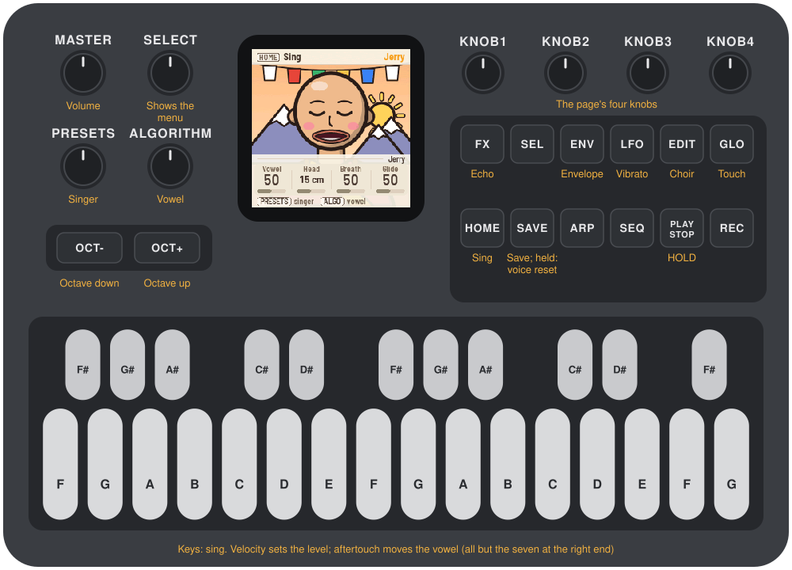
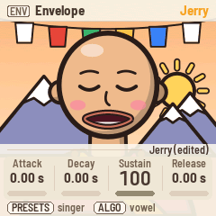

# MONK-1

MONK-1 turns the M-VAVE FM-1 into twelve singers. Each one sings in its own voice, from a monk to a
slice of pizza, on its own little stage, and its mouth follows the vowel as it sings. The voice is
MonkSynth, Jonathan Taylor's formant vocal synthesizer, and the keys feel how they are played:
how hard a key lands sets the note's level, and pressing harder on a held key moves the vowel. That
is velocity and aftertouch on an FM-1, with no changes to the hardware.



---

## Contents

1. Install
2. Getting started
3. Controls
4. The screen
5. Playing
6. The singers
7. The pages
8. MIDI
9. Saving
10. Troubleshooting
11. Parameters
12. Credits

---

## 1. Install

**Try it first:** the [MONK-1 emulator](https://charlesvestal.github.io/fm1-monk/emu/) runs the same
code in the browser, with sound. Where you press a key is how hard it lands, and dragging down on it
presses harder; on the computer keyboard, hold Shift to press harder.

**Install:** open the [web installer](https://charlesvestal.github.io/fm1-monk/install/) in Chrome or
Edge, connect the FM-1 with a USB data cable and press Install. Don't unplug it while it's
writing; when it finishes, the FM-1 restarts into MONK-1.

**Go back:** "Back to the stock firmware", at the bottom of the same page, puts M-VAVE's firmware
back (download the FM-1 V15 file from the link there, choose it, press the button). M-VAVE's own
updater, M-UPGRADE, works too.

> Installing other firmware is at your own risk. If the FM-1 ever won't start, see
> [Recovering an FM-1 that won't start](#recovering-an-fm-1-that-won-t-start).

<details><summary>Install from the command line</summary>

Download the firmware file (for example `monk-0.9.fwsc`) from the
[releases page](https://github.com/charlesvestal/fm1-monk/releases), get the MONK-1 source from
GitHub, install Python 3 with `pip3 install mido python-rtmidi`, and run:

```
python3 tools/fm1_install.py monk-0.9.fwsc
```

</details>

---

## 2. Getting started

1. **Sing.** Press a key: Jerry the monk sings it. Press harder and the note is louder; keep the key
   down and lean on it, and the vowel moves on, towards "ee".
2. **Glide.** Hold a key and press another: the voice glides up to it. Let go of the second and it
   glides back to the first.
3. **Change the vowel.** Turn ALGORITHM. The mouth follows.
4. **Meet the others.** Turn PRESETS: eleven more singers, each with its own voice.
5. **Shape the voice.** Press HOME and turn KNOB 1–4: vowel, head size, breath, glide. The other page
   buttons (EDIT, LFO, FX, ENV, GLO) each bring up four more.
6. **Hold a note.** Press PLAY: the note stays after you let go, and the next key takes over.

Each singer remembers your changes to its voice, and MONK-1 saves them by itself a few seconds after
you stop.

---

## 3. Controls

The drawing at the top shows them all; here they are in more detail.

| Control | What it does |
|---|---|
| Keys | Sing. One voice: the newest key held sounds; let go and it falls back to the key still held under it |
| How hard a key lands | The note's level (Touch: Velocity) |
| Pressing harder on a held key | The vowel moves, or the pitch rises, or both (Touch: Pressure) |
| OCT− / OCT+ | The keys an octave down or up, from −2 to +2 |
| KNOB 1–4 | The four knobs of the page on the screen |
| PRESETS | The singer |
| ALGORITHM | The vowel, whichever page is on the screen |
| SELECT | Shows the menu |
| MASTER | Volume |
| HOME | The Sing page: vowel, head, breath, glide |
| EDIT | The Choir page: voices, detune, spread, level |
| LFO | The Vibrato page: depth, rate, tune |
| FX | The Echo page: amount, time |
| ENV | The Envelope page: attack, decay, sustain, release |
| GLO | The Touch page: how pressure and velocity play |
| PLAY | HOLD: the note stays after the key |
| SAVE | Save now. Held 1.5 s: this singer's voice goes back to how it came |

SEL, ARP, SEQ and REC do nothing in MONK-1.

---

## 4. The screen


Most of the time the screen is the singer on its stage. The mouth follows the vowel and opens wider
as the note gets louder; with nothing playing, the singer blinks and mouths its vowels to itself.

A page button, a knob or PRESETS brings up the **menu** over the singer for a few seconds:

- **Header:** the button that opened the page (as a keycap), the page's name, and the singer.
- **Tag:** whose the knobs are: the singer's name (with "(edited)" once you've changed its voice), or
  "all singers" on the Touch page, which is shared.
- **Knobs:** KNOB 1–4, each with its name, value and a bar. The one you turned last stands out.
- **Bottom line:** what PRESETS and ALGORITHM do.

Messages such as "SAVED", "HOLD" or "OCTAVE +1" show in the header for a moment.

**The lights:** the page's button is lit, and PLAY shows green while HOLD is on. The other buttons glow dimly so
their labels can be read in the dark. While a key is held, the button lights go dark for an instant
each time the key is read, because a lit light upsets the reading; you may see them flicker.

---

## 5. Playing


**One voice.** MONK-1 sings one note at a time, as a singer does. The newest key held sounds; let go
and the voice goes back to the key still held under it. Moving between held keys glides (Sing:
Glide; at 0 it jumps).

**Velocity.** How hard a key lands sets the note's level. Touch: Velocity says how much: at 0 every
note is as loud as every other, at 100 a light touch is very quiet. A medium press, about velocity
100, keeps the level the singer was made with.

**Pressure.** Once a key is down, pressing harder on it moves the voice. MONK-1 counts the pressure
from where the key comes to rest after you play it, not from the moment it lands, so resting a finger
on a key does nothing and only leaning into it does. On the Touch page:

- **Pressure** says where it goes: VOWEL moves the vowel on, towards "ee"; PITCH bends the note up,
  as far as two semitones; BOTH does both; BOTH INV moves the vowel back, towards "oo", as the pitch
  rises.
- **Depth** is how far full pressure moves the vowel.
- **Sensitive** is how little a lean it takes: higher means a lighter press reaches full pressure.

The seven keys at the right end (C♯ to G) are wired differently inside the FM-1: they have velocity
but no pressure.

**HOLD.** PLAY turns HOLD on: the note keeps sounding after you let go, until another key takes over
or you press PLAY again.

**Octave.** OCT− and OCT+ move the keys an octave, from −2 to +2. MONK-1 starts at −1, where the
singers sit best: the lowest key is F2. A note already held ends correctly even if you change the
octave before you let go.

---

## 6. The singers


PRESETS turns through the twelve, from MonkSynth's iOS port: **Jerry** the monk, **Guppo**,
**Philip**, **Suze**, **Gerald**, **Bess**, **EeOo**, **Snider**, **Fipsy**, **Peppo**, **Marley** and
**Razor**. Each comes with its own voice (head size, breath, vibrato, choir, echo, envelope) and keeps
your changes to it: change Guppo's vibrato, visit Bess, and Guppo still has your vibrato when you come
back. Hold SAVE for 1.5 seconds to put the singer on the screen back to how it came; the others are
not touched.

The Touch page, the octave and the singer you were on are shared, not per singer.

---

## 7. The pages

Each page button brings up its four knobs. All values are per singer except on Touch.




| Page | Button | KNOB 1 | KNOB 2 | KNOB 3 | KNOB 4 |
|---|---|---|---|---|---|
| Sing | HOME | Vowel | Head | Breath | Glide |
| Choir | EDIT | Voices | Detune | Spread | Level |
| Vibrato | LFO | Depth | Rate | Tune | |
| Echo | FX | Amount | Time | | |
| Envelope | ENV | Attack | Decay | Sustain | Release |
| Touch | GLO | Pressure | Depth | Sensitive | Velocity |

- **Vowel:** from "oo" through "oh", "ah" and "eh" to "ee". ALGORITHM turns it too, from any page.
- **Head:** the size of the singer's vocal tract, in centimetres: a small head sings brighter vowels,
  a big one darker.
- **Breath:** noise in the voice, from clear to whispered.
- **Glide:** how long the voice takes to slide between held keys.
- **Voices:** a choir of up to ten, singing together. **Detune** spreads their pitches (in cents),
  **Spread** their head sizes; **Level** is the voice's volume.
- **Vibrato Depth** and **Rate**; **Tune** moves the whole voice up to 12 semitones either way.
- **Echo Amount** and **Time:** a stereo echo after the voice.
- **Envelope:** attack, decay and release in seconds (up to five), sustain as a level.

---

## 8. MIDI

Connect the FM-1 with a USB cable and it shows up as a MIDI device named "MONK-1 FM-1" (a Mac that
knew the FM-1 with other firmware may keep the old name until you remove it in Audio MIDI Setup).

**Out:** the notes you play, on channel 1, with the velocity they landed with, and polyphonic
aftertouch: each held key's pressure. Record a performance and it plays back on any synth that
listens to aftertouch.

**In:** MONK-1 sings what it receives:

| Message | What it does |
|---|---|
| Notes, any channel | Sing, with their velocity |
| Aftertouch (channel or polyphonic) | Pressure |
| CC 1 | Vowel |
| CC 5 | Glide |
| CC 7 | Level |
| CC 12 | Echo amount |
| CC 13 | Head |
| CC 120, 123 | All notes off |

---

## 9. Saving

MONK-1 saves by itself about four seconds after you stop changing things (and at most every ten
seconds). Press SAVE to save at once. What is saved: every singer's voice as you left it, the Touch
page, the octave and the singer you were on.

---

## 10. Troubleshooting

**Update mode:** hold OCT− and OCT+ together for five seconds. A countdown appears; let go before it
ends to cancel.

**Calibration:** if a button or knob does the wrong thing, hold OCT− and OCT+ while you switch the
FM-1 on. The screen then asks you to press each button and turn each knob in turn.

**Velocity or pressure feel off:** keys differ a little from one FM-1 to the next. Turn Touch:
Sensitive up if leaning on a key hardly moves the vowel, down if it jumps; Touch: Velocity down if
the levels vary too much.

**After a crash:** MONK-1 shows a red CRASH screen and restarts by itself a few seconds later. If you
report the problem, include the numbers on that screen (a photo is easiest) and what you were doing.

**Safe mode:** if MONK-1 crashes twice in a row while starting, it starts in SAFE MODE instead.
There's no sound, but USB works, so the web installer can reach it: reinstall MONK-1, or put the
stock firmware back from the same page. Press PLAY to try starting MONK-1 normally again. If even
safe mode fails twice, the FM-1 drops into the chip's own update mode, and only the rescue below can
reach it.

### Recovering an FM-1 that won't start

An FM-1 in the chip's own update mode shows a blank screen, and neither the web installer nor M-VAVE's
updater can see it. A script can put M-VAVE's firmware back, on a Mac, with the USB cable you already
have.

Open Terminal, paste this line and press Return:

```
bash -c "$(curl -fsSL https://raw.githubusercontent.com/charlesvestal/fm1-monk/main/tools/fm1_rescue.sh)"
```

1. If a window asks to install the command line developer tools, click Install. When it has finished,
   paste the line again.
2. If it asks for a password, type your Mac password (nothing shows as you type) and press Return.
3. When it says it's waiting, plug the FM-1 in and switch it on. The script catches it, checks the
   chip, saves a backup of the FM-1's memory in the `fm1-rescue` folder in your home folder, and asks
   before it writes anything.
4. Type **yes** and press Return. Don't unplug anything until it says it's restarting the FM-1. The
   FM-1 then starts into its original firmware, and you can install MONK-1 again from there.

The script downloads M-VAVE's FM-1 V15 firmware and JieLi's flash loader, and checks both against known
fingerprints. It writes only the firmware area of the memory, never the bootloader or the FM-1's own
settings, and checks everything it writes. Running it again is always safe. If it fails, copy
everything in the Terminal window and [open an issue](https://github.com/charlesvestal/fm1-monk/issues).
If the FM-1 never shows up at all, Felucca's
[FM-1-transporter](https://github.com/kurogedelic/FM-1-transporter) (a small RP2040 board wired to the
USB lines) can still reach it.

---

## 11. Parameters

| Page | Value | Range | Default |
|---|---|---|---|
| Sing | Vowel | 0–100 | per singer |
| Sing | Head | 0–30 cm | per singer |
| Sing | Breath | 0–100 | per singer |
| Sing | Glide | 0–100 | per singer |
| Choir | Voices | 1–10 | per singer |
| Choir | Detune | 0–50 cents | per singer |
| Choir | Spread | 0–100 | per singer |
| Choir | Level | 0–100 | per singer |
| Vibrato | Depth | 0–100 | per singer |
| Vibrato | Rate | 0–100 | per singer |
| Vibrato | Tune | −12 – +12 semitones | 0 |
| Echo | Amount | 0–100 | per singer |
| Echo | Time | 0–100 | per singer |
| Envelope | Attack, Decay, Release | 0–5.00 s | per singer |
| Envelope | Sustain | 0–100 | per singer |
| Touch | Pressure | Vowel, Pitch, Both, Both inv | Vowel |
| Touch | Depth | 0–100 | 50 |
| Touch | Sensitive | 0–100 | 50 |
| Touch | Velocity | 0–100 | 50 |
| PRESETS | Singer | the twelve | Jerry |
| OCT− / OCT+ | Octave | −2 – +2 | −1 (F2 to G4) |

---

## 12. Credits

MONK-1 is free software under the GNU General Public License, version 3. If you share the firmware,
you must also share its source code.

- The voice is **MonkSynth** by Jonathan Taylor (MIT), ported to the FM-1; MonkSynth is itself an
  homage to the Delay Lama plug-in by AudioNerdz (2002). MonkSynth is offered completely free of
  charge; if you enjoy it, you are kindly requested to make a donation at
  [savetibet.org](https://www.savetibet.org).
- The singers, their drawings and their voices come from MonkSynth's iOS port; the pressure routings
  from its port to Schwung.
- The velocity and pressure come from **Velo**, which reads how hard the FM-1's keys are pressed.
- The platform (hardware layer, USB, update loader, installer and storage) is from **Felucca** by Leo
  Kuroshita, Hügelton Instruments, by way of [X0X](https://charlesvestal.github.io/fm1-x0x/) and
  [FoMni-1](https://charlesvestal.github.io/fm1-fomni/). The menu's layout comes from
  [Polly](https://charlesvestal.github.io/fm1-polly/).
- The idea of running FM-1 firmware in the browser comes from [Groove OS](https://www.groove-os.com/).
- The fonts are Barlow Semi Condensed and Terminus (SIL Open Font License).

M-VAVE and FM-1 are trademarks of their owners. MONK-1 is not connected with M-VAVE or Hügelton
Instruments.
